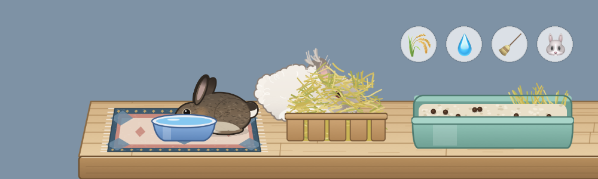
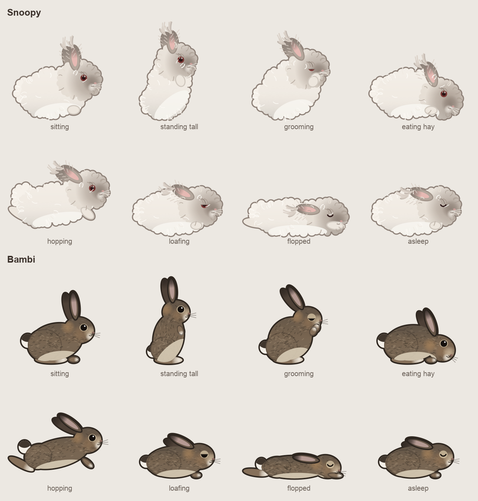

# Snoopy & Bambi

Two bunnies who live on your Mac desktop. They hop around, sit, loaf, flop
over, sleep, groom each other, eat hay, drink, use the litter box (mostly),
and do the occasional binky or zoomies. They're most active around dawn and
dusk, like real rabbits.

Snoopy is an English Angora (cream-white wool, taupe-gray face and ears
with smoky tassels, ruby eyes); Bambi is an agouti (ticked brown-gray coat,
cream eye ring and muzzle, dark-rimmed ears, white toes, tail dark on top and
white underneath). Both are drawn in code from their photos; see
`previews/` and `Sources/BunnyArt.swift`. Hover over a bunny to see its name.





## Getting it running on your Mac

You need macOS with Apple's command line tools (no Xcode needed). If you
don't have them yet, this opens the installer:

```bash
xcode-select --install
```

Then download this project (green **Code** button → **Download ZIP**, or
`git clone`), open Terminal in its folder and run:

```bash
./build.sh
```

That builds the app and puts it in your own Applications folder
(`~/Applications/SnoopyAndBambi.app`). Start it from Spotlight: **⌘Space**,
type **snoopy**, press **Return**.

## Starting and stopping

- The app is installed at `~/Applications/SnoopyAndBambi.app` (your own
  Applications folder). Start it from Spotlight: **⌘Space**, type
  **snoopy**, press **Return**.
- **Quick on/off:** do the same again while they're running (⌘Space,
  "snoopy", Return) and the bunnies hide; once more and they're back. Hidden
  bunnies use almost no CPU, and hay, water and reminders keep counting.
- There's no Dock icon. Everything is in the 🐰 menu at the top right of the
  menu bar, including **Hide bunnies** and **Quit**. The 🐰 button next to the
  litter box opens the same menu (handy if the menu bar icon is hidden
  behind the notch).
- The 🐰 turns into 🐰❗ when they need something.
- If you ever can't reach either menu, quit from Terminal: `killall SnoopyAndBambi`

## Looking after them

- The litter box, hay box and water bowl sit on a wooden platform in the
  lower-right corner, with a little Persian-style rug under the bowl for
  traction. The bunnies hop up to eat, drink and use the box.
- **🌾 Add hay**, **💧 Fresh water**, **🧹 Clean up**: buttons above the
  litter box (also in the 🐰 menu). The fourth button, 🐰, opens the menu.
- Hay runs out in about 12 hours; water should be changed daily. When either
  needs attention, the button gets a red badge, a bubble appears over the
  hay or bowl, and a bunny may go sit there and thump.
- Optional macOS notifications: 🐰 menu → **Reminder notifications**
  (macOS asks for permission the first time). Not tested yet; the in-pen
  reminders work either way.
- **Drag a bunny** to move it out of your way. It dangles while you carry
  it, then thumps in protest when you put it down and sulks in a loaf there
  for a while before going about its business.
- **Click a poop** to clean it up. **Click a bunny** to pet it. Everywhere
  else, clicks go straight through to whatever is underneath (but a bunny
  sitting on top of something does block it, so use **Hide bunnies** if one
  is napping on your work).
- Litter habits: 8% of litter trips don't quite make it (a few poops, and
  sometimes a pee, on the floor), plus roughly one stray poop an hour while
  they hop around. The rest goes in the box.
- Time keeps passing while the app is closed: hay and water go down and the
  litter box fills up.

## Where things are

- Your bunnies' state is saved in `~/Library/Application Support/SnoopyAndBambi/state.json`,
  with a log next to it (`bunnies.log`).
- By default the bunnies live in a strip along the bottom of the main
  screen, just above the Dock; the rest of the screen is left alone.
  🐰 menu → **Stay along the bottom of the screen** turns that off to let
  them roam the whole screen.
- They stay on the main screen, above the Dock. They show on every
  desktop and should stay out of full-screen apps (not tested yet). Use
  **Hide bunnies** when presenting or sharing your screen.
- 🐰 menu → **Keep bunnies on top of windows** (on by default). Turn it off
  to have them live on the desktop behind your windows.

## Building

Needs only Apple's command line tools (no Xcode). This builds the app and
installs it to `~/Applications/SnoopyAndBambi.app` (it's built in a temporary
folder first, so file attributes from iCloud Drive or downloads can't upset
code signing). Quit the running bunnies and start them again afterwards to
pick up the new version:

```bash
./build.sh
```

Source is in `Sources/`: `BunnyArt.swift` (the drawings), `Bunny.swift`
(behavior), `Corner.swift` (litter box, hay, bowl, buttons),
`PenScene.swift` (the world), `Overlay.swift` (see-through window and
click-through), `AppDelegate.swift` (menu bar), `Model.swift` (saving).

Test switches: `--test-seconds N` (quit after N s), `--snapshot file.png`,
`--state-dir DIR` (use a separate save folder), `--speed X` (needs change X
times faster), `--verbose`, `--render-art DIR` (draw every pose to PNGs).
